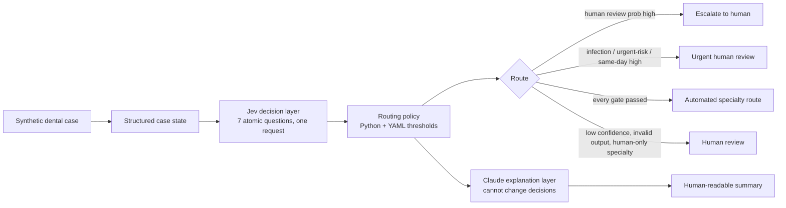

# DentoRoute

**From dental cases to structured decisions.**

Probabilistic dental triage and referral routing, built on [TypeSafe Jev](https://typesafe.ai).

> **Research prototype. Not for clinical diagnosis or treatment.** All data is synthetic. DentoRoute is not a medical device, has not been clinically validated, and does not replace a dentist or doctor.

<p align="center"></p>

A 53-second walkthrough video is in [docs/media/dentoroute_video.mp4](docs/media/dentoroute_video.mp4). Everything in it uses synthetic cases and simulated Jev responses.

## What this is

Most LLM demos ask a model for an answer and trust it. DentoRoute asks a different question: if the decision layer gives you probabilities and a confidence value, how should software use them to decide when it may act and when a person has to look?

A synthetic dental case goes in. Jev answers seven atomic questions in one request (urgency, specialty, infection concern, same-day review, human review, complexity, referral priority), each with probabilities. A small deterministic policy, conservative by design, turns those probabilities into one of four routes. Automation is the exception: a case is automated only when every safety check passes. Claude then writes a plain-language explanation that is not allowed to change anything. When Jev is unsure, the case goes to a human instead of being forced into a category.



## Features

- **Synthetic dataset.** 525 cases across 21 scenario categories (routine exams to severe infection warnings, plus deliberately vague cases), generated from a fixed seed.
- **Jev decision layer.** Seven atomic questions in one request using Score, Choice and Noul primitives. The Jev code lives in one file, uses the official SDK and the `jev-latest` alias, and every response is validated before use.
- **Conservative safety gate.** Four routes chosen by seven ordered rules (R0 to R6): invalid output, human-review probability, infection concern, urgent-risk signals including a small learned risk score, confidence floors, human-only specialties, and only then automation. Thresholds are in `config/routing_policy.yaml`, with hard limits in code that the YAML cannot loosen. Each result says which rule fired and why, with the actual numbers. Details in [docs/safety_gate.md](docs/safety_gate.md).
- **Cost-sensitive policy study.** Old policy against revised policy on a train / calibration / holdout split: false automation, unnecessary human review, coverage and automation accuracy, with a confidence bound on missed urgent cases and a cost-ratio sensitivity check.
- **Grounded explanations.** Claude sees only the findings present in the case. Its signal list is restricted to real findings, its text is scanned for unsupported clinical claims, and a deterministic template takes over if the check fails or Claude is unavailable.
- **Benchmark.** Jev against a deterministic rubric, and optionally Claude on the same cases with forced structured output. Accuracy, ordinal error, precision and recall, schema compliance, latency, cost (when prices are configured), and a paired comparison with bootstrap confidence intervals.
- **Calibration analysis.** Reliability diagrams, Brier score, ECE, confidence and probability histograms, accuracy by confidence band, and a direct answer to "does higher confidence mean higher accuracy?".
- **Streamlit app.** Seven pages (the Benchmark Lab has a Safety policy tab): Home, Case Simulator, Decision Dashboard, Benchmark Lab, Case History, Architecture, About / Safety. A Research Mode toggle shows raw responses, thresholds, latency and cache status.
- **Demo Mode.** Runs with no API keys, using a clearly labelled simulator.
- **FastAPI backend**, SQLite history and cache, CSV/JSON benchmark export, Markdown/JSON case reports.
- **Tests.** 244 tests, 96% coverage of the backend, with Jev and Claude mocked (no keys needed). Every safety rule has its own tests.

## Quick start

Requires Python 3.11 or newer.

```bash
git clone https://github.com/DrEnosh/dentoroute.git && cd dentoroute
python -m venv .venv && source .venv/bin/activate     # Windows: .venv\Scripts\activate
pip install -r requirements.txt
cp .env.example .env                                  # leave keys blank for Demo Mode

streamlit run frontend/app.py                         # the UI, http://localhost:8501
```

That is enough to use everything in Demo Mode. The UI runs the API in-process when no backend is listening. To run the API separately:

```bash
uvicorn backend.main:app --reload --port 8000         # http://localhost:8000/docs
```

If the backend is up, the Streamlit app finds it through `DENTOROUTE_API_URL` and uses it.

## Environment variables

| Variable | Purpose | Default |
|---|---|---|
| `TYPESAFE_API_KEY` | Jev API key. Required for live mode. | empty |
| `ANTHROPIC_API_KEY` | Claude key. Enables Claude explanations and the Claude benchmark. | empty |
| `DENTOROUTE_DEMO_MODE` | `auto` (live if a Jev key exists, else demo), `true`, or `false`. | `auto` |
| `JEV_MODEL` | Jev model alias. | `jev-latest` |
| `CLAUDE_MODEL` | Claude model. | `claude-sonnet-5-5` |
| `DENTOROUTE_API_URL` | Backend URL for the UI. | `http://localhost:8000` |
| `*_PRICE_*_PER_MTOK` | Optional token prices (USD per million) to report cost. Without them, cost shows as "not measured". | empty |
| `BENCHMARK_WORKERS` | Concurrency for benchmark runs. | `6` |

Keys are read from the environment or `.env`, which is git-ignored. They are never hard-coded and are redacted from logs.

## Demo Mode

With no `TYPESAFE_API_KEY` (or with `DENTOROUTE_DEMO_MODE=true`) the app shows the banner "Demo Mode — using simulated Jev responses." A deterministic simulator produces responses in Jev's format, and they pass the same validation as live ones. The simulator is not Jev. Benchmark runs made from it are labelled SIMULATED, report no latency or cost, and are never compared with Claude.

For live mode: set `TYPESAFE_API_KEY`, and set `DENTOROUTE_DEMO_MODE=false` if you want missing keys to be an error rather than a silent switch to demo.

## Running the benchmark

From the UI: Benchmark Lab, then "Run a benchmark".

From the command line:

```bash
python scripts/run_benchmark.py --demo                        # simulated, all 525 cases, about a second
python scripts/run_benchmark.py --provider jev --limit 100 --live
python scripts/run_benchmark.py --provider both --live        # Jev vs Claude, needs both keys
```

Results are saved to the local database and exported to `results/` as CSV and JSON. In the app, the Export tab downloads the same files. Methodology, metrics and the threats to validity are in [docs/benchmark_methodology.md](docs/benchmark_methodology.md).

Regenerate the dataset with `python scripts/generate_dataset.py`.

## Safety-gate study

The first routing policy automated 61 cases on the simulated run that the reference rubric says are urgent or need a human, because urgent review waited for an urgency score of 2.5 and a clean URGENT call scores about 2.0. The current gate replaces it. To compare the two:

```bash
python scripts/tune_policy.py --demo          # simulated Jev outputs, writes results/policy_study.json
python scripts/tune_policy.py --live          # after a live benchmark of all cases
python scripts/tune_policy.py --live --write  # also write the tuned thresholds to config/routing_policy.yaml
```

The risk score is fitted on a train split, thresholds are chosen on a calibration split under a missed-urgent budget of zero, and the numbers below come from a holdout split that is touched once, after the policy is frozen. The tuner refuses holdout rows.

Result on the demo simulator, holdout of 158 cases (24 reference-urgent). These are simulated outputs, not Jev.

| | Old policy | Revised policy |
|---|---|---|
| Missed urgent cases | 9 | 0 (95% upper bound on the rate: 11.7%) |
| False automation | 26 | 0 |
| Unnecessary human review | 26 | 71 |
| Coverage (share automated) | 65.2% | 20.3% |
| Specialty accuracy when automated | 95.1% | 100.0% |

The trade is real: safer routing sends far more cases to a person. At a 2:1 cost ratio between a missed urgent case and an unnecessary review, the old policy has the lower cost per case. Zero misses on 24 urgent cases is not zero risk. Rerun on live Jev outputs before reading anything into these numbers.

**Every threshold in this repository is a research-demo threshold, not a clinical threshold.** See [docs/safety_gate.md](docs/safety_gate.md).

## Running the tests

```bash
python -m pytest                     # all tests
python -m pytest --cov=backend       # with coverage
```

No API keys are needed. The real TypeSafe SDK is exercised against a mock HTTP transport, Claude is replaced by a fake client, and the Streamlit pages are driven with Streamlit's AppTest.

## API

| Method | Path |
|---|---|
| GET | `/` , `/health` |
| POST | `/api/cases/generate`, `/api/cases/evaluate` |
| POST | `/api/jev/evaluate`, `/api/claude/explain` |
| POST | `/api/benchmark/run` |
| GET | `/api/policy` |
| POST, GET | `/api/policy/study` |
| GET | `/api/benchmark/results`, `/api/benchmark/export` |
| GET | `/api/cases/{case_id}`, `/api/cases/{case_id}/report`, `/api/history` |

Interactive docs are at `/docs`. Errors return readable JSON: 404 unknown case, 503 missing key, 502 provider failure.

## Project structure

```
backend/
  main.py                  FastAPI app
  routers/                 endpoints
  services/
    jev_service.py         the only module that touches the TypeSafe SDK
    routing_service.py     deterministic routing policy (R0-R6)
    policy_service.py      hard safety limits and policy validation
    risk_model.py          small logistic reference-risk score
    split_service.py       train / calibration / holdout split
    policy_eval_service.py threshold tuning, cost-sensitive evaluation
    claude_service.py      explanation layer + Claude benchmark baseline
    signal_service.py      grounding check for explanations
    pipeline_service.py    case -> decisions -> route -> explanation -> history
    benchmark_service.py   runs, comparison
    metrics_service.py     accuracy, F1, paired comparison
    calibration_service.py reliability, ECE, Brier, risk-coverage
    demo_simulator.py      Demo Mode responses
    synthetic_case_service.py, ground_truth_service.py, export_service.py
  schemas/ repositories/ models/ utils/
frontend/
  app.py                   Streamlit entry point
  pages/                   seven pages
  components/              charts, theme, result rendering
  api_client.py            HTTP with in-process fallback
config/                    routing_policy.yaml (active), routing_policy_legacy.yaml (baseline)
data/                      synthetic_cases.json, ground_truth_rules.yaml, demo_cases.json
docs/                      architecture, benchmark methodology, safety, safety gate
scripts/                   generate_dataset.py, run_benchmark.py, tune_policy.py
tests/
```

## Safety and limitations

Please read [docs/safety.md](docs/safety.md). The short version:

- Everything is synthetic. Do not enter real patient information.
- Reference labels come from a rule set written for this project. No clinician reviewed it. Matching it does not mean a model is clinically right.
- The rubric and the question wording share an author, so agreement is partly built in.
- Routing thresholds are research-demo thresholds, not clinical thresholds. The shipped values were tuned on the demo simulator, not Jev. The holdout is small, so zero missed urgent cases still leaves a wide upper bound.
- The simulator makes about a quarter of reference-urgent cases look benign, and no probability-based gate can catch a case the model thinks is benign.
- Claude's confidence is self-reported and Jev's is computed from a probability distribution. They are different kinds of number.
- Live Jev and Claude paths are tested against mocks in this repository. Numbers from real API runs have to come from your own keys.

## Roadmap

- Repeat benchmarks across seeds and report variability.
- Re-tune the safety gate on live Jev outputs and repeat the study across several split seeds.
- Calibration repair (temperature scaling or isotonic regression) and a before/after comparison.
- Rubric review by dental professionals, and harder, noisier case generation.
- Add reasoning-heavy and multimodal inputs (radiograph findings) to the case state.
- Compare more decision strategies (self-consistency, ensembles) against Jev's single-request approach.

## License

MIT. See [LICENSE](LICENSE).

Built by Dr. Enosh A Paulson.
