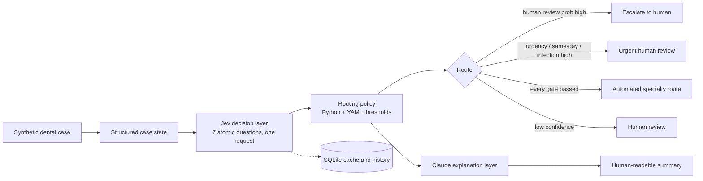

## Overview

A case flows through four layers. Each has one job and a narrow interface.

## Layers

### 1. Case state (`backend/schemas/case.py`)

A Pydantic model with `extra="forbid"`. Boolean findings are explicit, so a negative ("no fever") is sent as `false` rather than being omitted. `to_jev_state()` removes the synthetic patient ID and null values. Reference labels and scenario categories never enter the model input.

### 2. Decision layer (`backend/services/jev_service.py`)

The only file that imports the TypeSafe SDK. It builds seven questions and sends them in one `system_one` call:

| Question | Primitive |
|---|---|
| urgency | Score, 4 ordered levels |
| specialty | Choice, 10 labels |
| infection_concern | Noul |
| same_day_review | Noul |
| human_review | Noul |
| complexity | Score, 4 levels |
| referral_priority | Score, 4 levels |

Responses are validated before anything else sees them: types match, labels are in the closed set, probabilities are within [0, 1] and distributions sum to one within 0.02. A failed check raises `InvalidModelOutputError`. SDK exceptions (authentication, timeout, connection, rate limit, API error) map to `JevServiceError` with a message safe to show in the UI.

Live responses are cached in SQLite, keyed by a hash of the case state, question-set version and model name. In Demo Mode, `demo_simulator.py` produces a deterministic response in the same shape, which passes through the same validation.

### 3. Routing policy (`backend/services/routing_service.py`, `config/routing_policy.yaml`)

First matching rule wins (full detail in `docs/safety_gate.md`):

- R0: invalid or missing model output, or a provider failure: human review.
- R1: human-review probability high: escalate to human.
- R2: infection-concern probability high: urgent review.
- R3: urgency score, P(URGENT or EMERGENCY), same-day probability or the learned reference-risk score high: urgent review.
- R4: a confidence floor missed, or an infection, same-day or human-review answer too uncertain to trust: human review.
- R5: the chosen specialty is on the human-only list: urgent or human review.
- R6: every check passed: automated specialty route.

Every result carries the rule that fired, the reasons in plain text with the actual numbers, a confidence band, the policy name and a snapshot of the thresholds. Thresholds live in YAML so they can change without touching code, but `policy_service.validate_policy` enforces hard limits in code on every call, so a YAML file can make the gate stricter and never looser. The old policy is kept as `config/routing_policy_legacy.yaml` for comparison only. All thresholds are research-demo values, not clinical ones.

Selecting thresholds is a separate offline step (`policy_eval_service.py`, `scripts/tune_policy.py`): a train/calibration/holdout split (`split_service.py`, saved in `data/splits.json`), a risk score fitted on train (`risk_model.py`), thresholds chosen on calibration, and a holdout report.

### 4. Explanation layer (`backend/services/claude_service.py`)

Claude receives the findings present in the case, the findings explicitly absent, the engine's decisions and the routing result. It must call a `submit_explanation` tool. The `urgency_signals` field is a JSON-schema enum of the findings actually present. The prose is then scanned (`signal_service.py`) for clinical terms the case does not support, with negations allowed. On a failed check, an API error or a missing key, `template_explanation` produces a deterministic summary instead and says so.

The same service can answer the seven questions directly (`decide`) for the benchmark. That path is never used to route a case.

## Orchestration

`pipeline_service.evaluate_case` runs decision, routing and explanation, then stores the run. Provider failures come back as a structured error rather than an exception, and are still saved so Case History shows them.

## API (`backend/main.py`, `backend/routers/`)

| Method | Path | Purpose |
|---|---|---|
| GET | `/` | service info and mode |
| GET | `/health` | status, mode, whether keys are configured (never the keys) |
| POST | `/api/cases/generate` | draw or generate synthetic cases |
| POST | `/api/cases/evaluate` | full pipeline for a case or case ID |
| POST | `/api/jev/evaluate` | decision layer plus routing only |
| GET | `/api/policy` | active routing policy, hard limits, provenance |
| POST / GET | `/api/policy/study` | run / fetch the train-calibration-holdout study (candidate only, never changes the active policy) |
| POST | `/api/claude/explain` | explanation layer |
| POST | `/api/benchmark/run` | run and store a benchmark |
| GET | `/api/benchmark/results` | latest stored runs and comparison |
| GET | `/api/benchmark/export` | CSV or JSON of a run |
| GET | `/api/cases/{case_id}` | case, reference labels, latest run |
| GET | `/api/cases/{case_id}/report` | Markdown or JSON case report |
| GET | `/api/history` | stored evaluations with filters |

Errors return JSON with a readable message: 404 for unknown cases, 503 for missing keys or database problems, 502 for provider failures, 422 for invalid input.

## Frontend (`frontend/`)

Streamlit with `st.navigation` and seven pages. `api_client.py` talks to the backend over HTTP if `DENTOROUTE_API_URL` answers, and otherwise runs the same FastAPI app in-process, so `streamlit run frontend/app.py` works on its own with identical behaviour.

## Storage

SQLite via SQLAlchemy: case runs, benchmark runs and results, and the Jev cache. The file is `data/dentoroute.db` and is git-ignored.

## Design decisions

- Jev is isolated behind one module so the rest of the code never sees SDK types.
- Policy is code, not a prompt. It can be read, tested and changed without calling a model.
- Failure is a first-class result. Any invalid output ends in human review.
- Demo Mode shares the validation path with live mode, so the simulator cannot return something live mode would reject.
